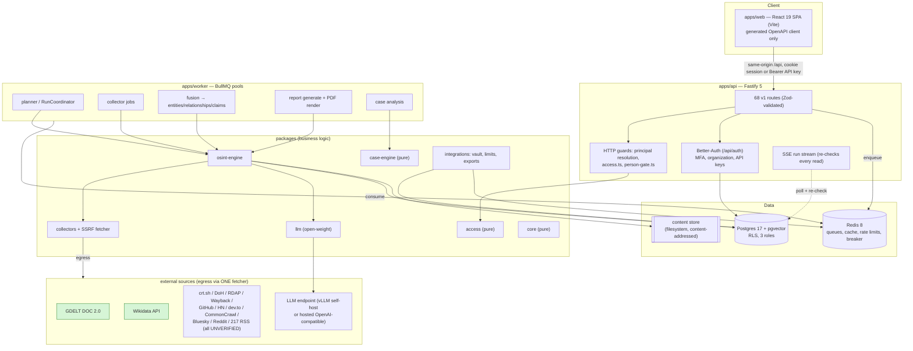
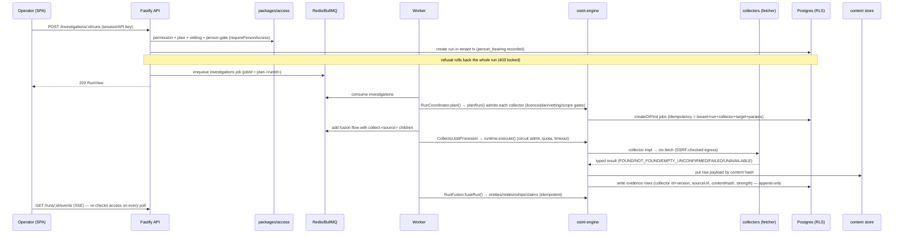
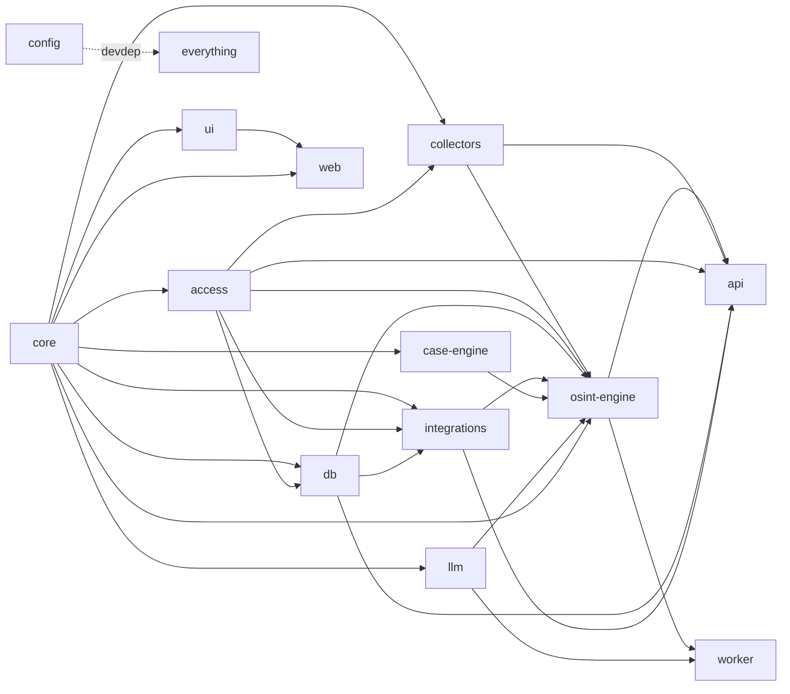

# 02 — Reconstructed Architecture

All claims cite `file:line`. Architecture is a **modular monolith**: one deployable API, one worker codebase run as queue-selected pools, one SPA, backed by Postgres + Redis. No microservices (ADR §12 explicitly rules them out for v1).

---

## 1. High-level architecture

*Green = the 3 collectors that can actually run (`contact.phone` is local-only, so only GDELT + Wikidata make network calls today).*

---

## 2. Request → storage data flow (a run)

**The single writer of evidence rows** is `CollectionExecutor.persistEvidence()` (`packages/osint-engine/src/executor.ts:172-196`), driven only from `CollectorJobProcessor.#record` (`jobs/collector-job.ts:311`). FOUND only; each evidence row carries collectorId/version, sourceUrl, contentHash, observedAt/collectedAt (both nullable, never clock-filled), and claimStrength.

---

## 3. Module dependency map

Enforced by `packages/config/scripts/boundaries.test.ts` (release-blocking). `core`, `access`, `case-engine` are pure (no I/O); `case-engine` additionally forbids clock/randomness, pinned by an AST purity test (`case-engine/test/purity.test.ts`).

---

## 4. API surface (68 routes)

Full enumeration with handlers, schemas, auth and gating is in [03-external-services-and-apis.md](03-external-services-and-apis.md) §API. Summary by router (all under `/api/v1` unless noted; all protected routes accept session cookie **or** `Bearer ak_<tenant>_<key>_<secret>` API key):

| Router | Routes | Notes |
|---|---|---|
| `health` | `GET /health` (public, liveness only) | does not probe PG/Redis |
| `openapi` | `GET /api/v1/openapi.json` (public) | served from `app.swagger()` |
| `auth` (hidden) | `POST /api/auth/sign-up/email`, `.../accept-invitation` | anti-enumeration sign-up (returns synthetic user; CLAUDE.md §1) |
| `session` | 7 routes: sign-in, MFA verify/enrol/confirm, set tenant, sign-out | public + trusted-origin; no token ever in a body |
| `me` | `GET /me` | profile + permissions + plan/vetting |
| `investigations` | create/list/read | |
| `runs` | start, list, read, **`GET /runs/:id/events` (SSE)**, `POST /jobs/:id/replay`, `GET /usage` | run start + read + replay are person-gated |
| `reports` | create, list, read, `GET /reports/:id/export/:format`, PUT report-marking | person-gated; PDF re-hashed on serve |
| `scope-authorisations` | create (session-only), list, revoke | required for ACTIVE collection |
| `cases` | CRUD + pins (create/list/delete) | pins person-gated on the pinned subject |
| `case-analyses` | request, list, read | person-gated; event-sourced |
| `entities` | list, merge-candidates, read, relationships, entity-merges (create/undo, session-only) | all person-gated, snapshot reads |
| `evidence` | read, **`GET /evidence/:id/payload`** | raw payload = octet-stream + nosniff + CSP sandbox + re-hash |
| `explore` | `GET /graph`, `GET /timeline` | person-gated whole-neighbourhood |
| `members` | list, invitations list/create (session-only), change-role, remove | |
| `settings` | retention read/write, report-marking | retention `enforced:false` |
| `estimates` | `POST /estimates` | plans without running; costs always `null`+reason |
| `collectors` | `GET /collectors` | registry + per-deployment runnability |

Guarantees enforced by `packages/config/scripts/person-gate-guard.ts` (route-gating audit) and `apps/api/test/route-access.test.ts` (release-blocking): every route is classified, registered, and gated through the shared helpers; every gated GET uses a `snapshot:true` (REPEATABLE READ) transaction (D-32).

---

## 5. Background jobs & queues

Queues (`packages/osint-engine/src/jobs/queues.ts:51-61`): `investigations`, `fusion`, `dead-letter`, `reports`, `report-renders`, `case-analyses`, and one `collect.<sourceId>` per upstream source. A run is a **BullMQ flow**: a `fusion` parent with `collect.<source>` children; a failed child uses `ignoreDependencyOnFailure` so fusion still runs and the run becomes PARTIAL.

| Processor | File | Does |
|---|---|---|
| Planning | inline `queues.ts:721` → `RunCoordinator.plan` (`runs.ts:58`) | plans a run into jobs, adds the flow |
| Collector job | `jobs/collector-job.ts:107` | claim→collect→decide→record; circuit + quota + timeout |
| Fusion | `fusion/fuse.ts:86` | result → entities/relationships/claims, idempotent |
| Report generate | `reports/generator.ts:94` | person-gate re-check → assemble → optional LLM synthesis → PENDING PDF |
| Report render | `reports/renderer.ts:124` | pdf-lib render → content store |
| Case analysis | `jobs/case-analysis.ts:125` | person-gate-first on snapshot → analyse → one finishing event |

Reliability (ADR §6 / CLAUDE.md §5), all present: enqueue timeout (`DEFAULT_ENQUEUE_TIMEOUT_MS=5000`), per-source bulkheads via `Queue.setGlobalConcurrency`, Redis circuit breaker (fail-closed), dead-letter queue (`removeOnFail:false`, nothing consumes it) + `JobReplayer`, idempotency keys, and cause-aware retry (`UNAVAILABLE` retries with jittered exponential backoff honouring `Retry-After`; auth/invalid-target fail fast). Credit metering is keyed by attempt and written in the same tx as the state transition, so retries never double-charge. Detail in [05-crawlers-scrapers-data-sources.md](05-crawlers-scrapers-data-sources.md).

---

## 6. State management

- **Server state:** Postgres under RLS; all access through `db.withTenant()` tenant transactions and repositories bound to a live `TenantScope`.
- **Queue/ephemeral state:** Redis (BullMQ jobs, rate-limit counters, circuit-breaker state, LLM response cache).
- **Client state:** TanStack Query (server cache) + React local state + two React Contexts (`ProvenanceContext`, `SlotsContext`). `zustand` is declared but unused.
- **Config/flags:** no separate flag system; behaviour is driven by the validated env schema + `resolveLlmConfiguration` (vLLM off by default, hosted LLM `NOT_CONFIGURED` when unset, access methods default `open,official,licensed` never `operator`).

---

## 7. Implemented vs partial vs referenced-but-missing

| State | Items |
|---|---|
| **Implemented** | All 68 API routes; auth/MFA/enrolment; run lifecycle; collector execution for the 3 runnable sources; fusion; reports + 4 export formats; case analysis; SSE stream with full re-check; OpenAPI generation; provisioning; the full reliability stack; RLS + repositories; vault; exporters |
| **Partial / by design off** | 228 UNVERIFIED collectors (frozen until licence recorded); LLM synthesis (`NOT_CONFIGURED` default); person module (`person/search` 501, no person collector); contradiction review (computed in case-engine but not yet surfaced in the stored analysis doc) |
| **Referenced but missing** | `services/vision` (Python GPU); `infra/` tool containers (SpiderFoot/theHarvester/IVRE/nmap); Dockerfiles; S3 content store; retention-deletion enforcement; monitors/alerts scheduler; media-forensics |
| **Aspirational (docs only)** | Most providers in `Vestigo_Global_News_Providers_and_APIs.md`; Neo4j graph store (ADR Phase 2); fuller CI/deploy pipeline (ADR §10); VA/PT active capability (`docs/vapt/`) |
